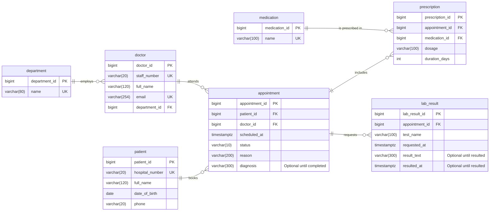

# Oluwasinayomi Hospital ER Diagram

## Reading the diagram

- **PK** identifies one row. **FK** links to another table. **UK** means the value is unique.
- `||` means exactly one. `o{` means zero or many.
- A department employs many doctors; each doctor belongs to one department.
- A patient and a doctor can each have many appointments; each appointment has one patient and one doctor.
- An appointment can have many prescriptions and many lab results. A medication can appear in many prescriptions.

Rules not visible in the diagram: a doctor cannot have two **scheduled** appointments at the same time (partial unique index `doctor_one_booking_per_slot`); a diagnosis exists only on a completed appointment; a lab result's text and time are either both present or both empty.
